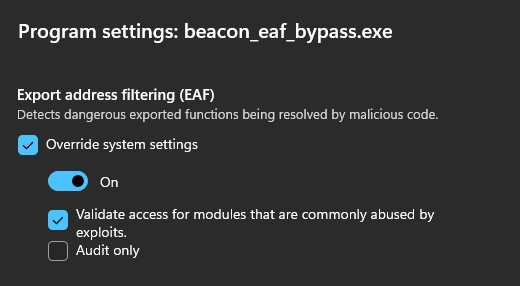
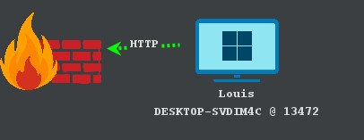

# OdinLdr


Cobaltstrike reflective loader for beacon and postex

# UDRL

- Use Indirect Syscall with Synthetic Stackframe for Nt-Allocate/Protect-VirtualMemory
```
 # Child-SP          RetAddr               Call Site
00 00000000`00cdf5d8 00007ffc`d9a12c66     ntdll!NtAllocateVirtualMemory+0x12
01 00000000`00cdf5e0 00007ffc`da8c7388     KERNELBASE!Internal_EnumSystemLocales+0x406
02 00000000`00cdf9c0 00007ffc`dbefcca5     KERNEL32!BaseThreadInitThunk+0x28
03 00000000`00cdf9f0 00000000`00000000     ntdll!RtlUserThreadStart+0x35
```
- Call LoadLibraryA with Synthetic Stackframe

```
 # Child-SP          RetAddr               Call Site
00 00000000`00c3f518 00007ffc`d9a12c66     KERNEL32!LoadLibraryAStub
01 00000000`00c3f520 00007ffc`da8c7388     KERNELBASE!Internal_EnumSystemLocales+0x406
02 00000000`00c3f900 00007ffc`dbefcca5     KERNEL32!BaseThreadInitThunk+0x28
03 00000000`00c3f930 00000000`00000000     ntdll!RtlUserThreadStart+0x35
```

- Use gadget to read module header and avoid presence of EAF




# Credit

- Sektor7 : https://institute.sektor7.net/
- Cobaltstrike : https://www.cobaltstrike.com/
- susMdT : https://github.com/susMdT/LoudSunRun

# Thanks

- m_101 : Tips to bypass EAF
- Tripané : Help for debug